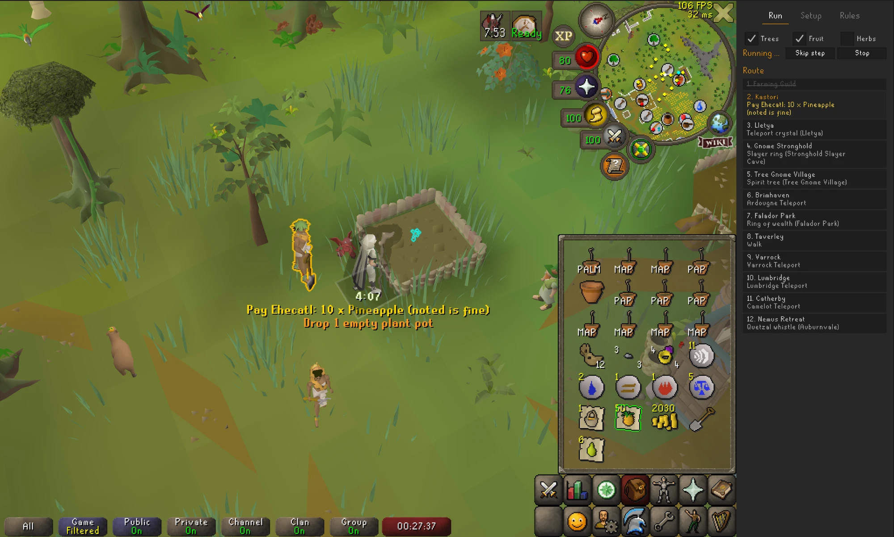
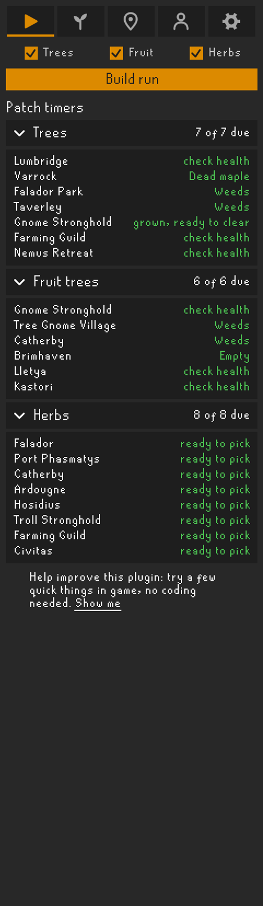
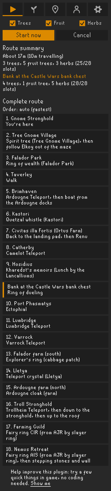
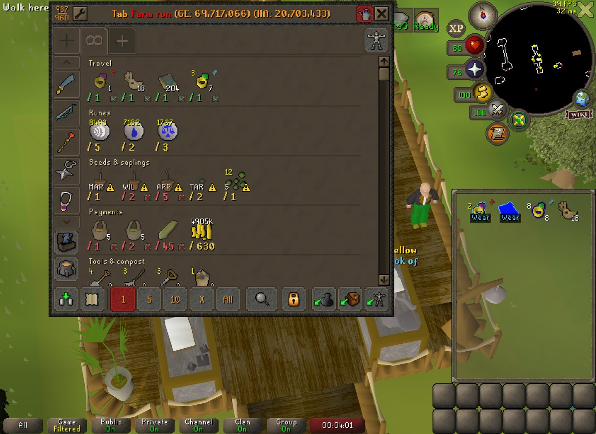
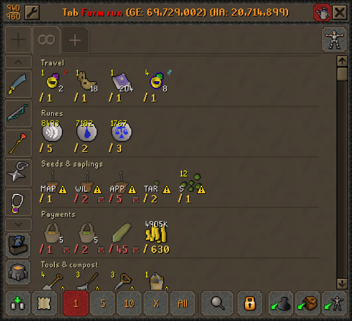
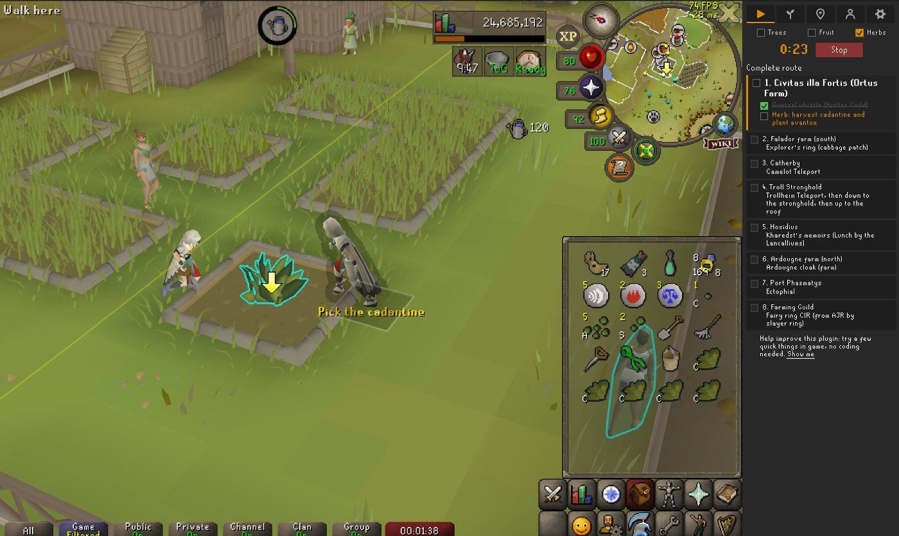
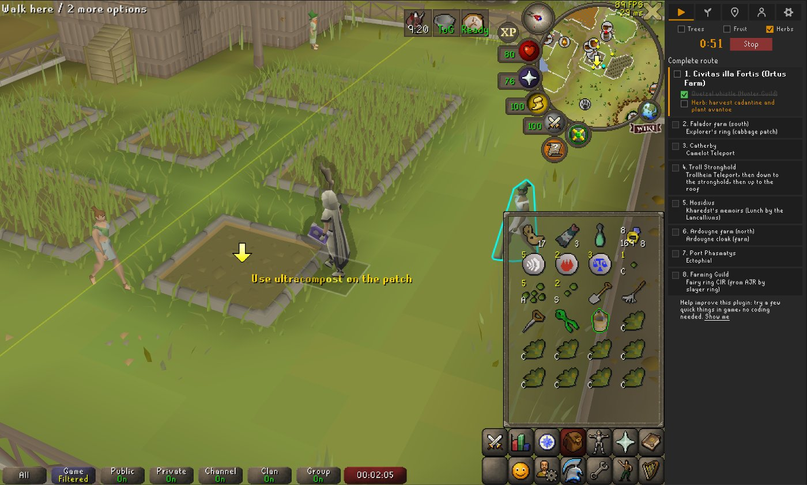
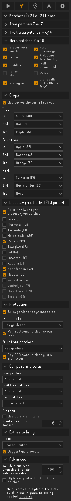
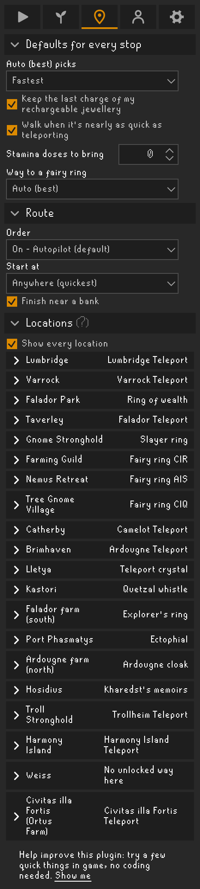
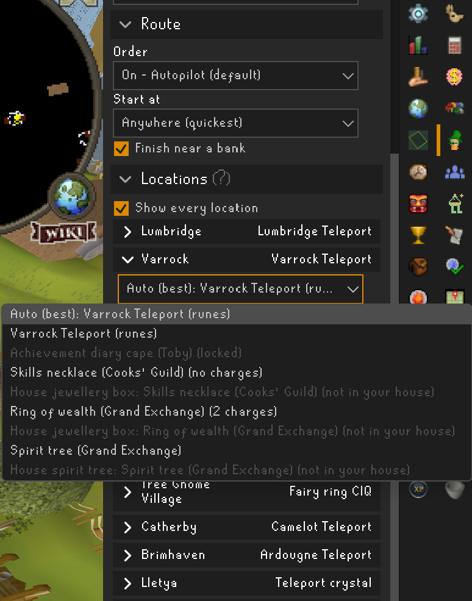

# Farm Run Autopilot

Plans and guides combined tree, fruit tree, herb, allotment, flower and hops farming runs: what's due, the
fastest route, exactly what to bring, and step-by-step guidance at every patch.

The plugin never clicks, types or acts for you. It only shows information.

## Features

**Run tab**
- Patch timers for every run type, with what's due now and what's ready soon.
- One route across every due patch, using the teleports, items and unlocks you actually have. The route starts
  at the stop nearest you on foot and can end near a bank. Choose the order: **Autopilot** (fastest, the
  default), **Meta** (the wiki's order), or your own (drag a stop to move it).
- The route shows each stop's way there, the whole run's time and where you'll stop at a bank when everything
  doesn't fit in one inventory.
- Backup crop choices for when you run out, and your most valuable herbs sent to disease-free patches first.

  
  

**Bank**
- After you press **Build run**, a flashing "Farm run" button in the bank shows just the items you need, with
  how many of each: seeds and saplings, gardener payments (noted is fine), compost, tools, coins, runes or
  tablets and travel items. Green is carried, yellow is in your bank or at the tool leprechaun, red is missing.
  A vine grows round the button while it waits for you.
- Equipment is chosen slot by slot: a staff that covers the run's runes is wielded ahead of magic secateurs.
- Barbarian seed planting is read from the game; once you've learned it, herb runs don't ask for a seed dibber.
- At a bank stop partway through a big run, it shows what to deposit first, then what to take for the rest.

**Seed vault**
- In the Farming Guild's seed vault, a button by the close button shows a "Farm Run Autopilot" section at the
  top with the run's seeds and how many you have and need. Withdraw from it as usual.
- Seeds only the vault has are named with where to take them. For a run that banks partway, choose on the
  Account tab whether to take every seed at the start and keep the later ones in your bank, or to bank at the
  Farming Guild.

  
  

**During a run**
- Once you have everything (tools at the tool leprechaun count), the run starts itself, with each stop's steps
  as tick boxes on the Run tab and the current step under your character: where to go next, then what to do
  at each patch (pick, check health, clear, rake, compost, plant, pay the gardener).
- The patch is outlined with a hint arrow over it; the gardener is outlined when it's time to pay; the seed,
  compost, tool or teleport to use next is outlined in your inventory, and the spell to cast in your spellbook
  gets the growing vine. Untick "Growing vine highlights" in Settings for plain outlines.
- Journeys are spelled out: boats, quetzals, Elkoy, hot air balloons, and Agility shortcuts when you have the
  level (the way round when you don't).
- With [Shortest Path](https://github.com/Skretzo/shortest-path) installed, a walking line to the next patch or
  bank. Your Shortest Path settings are put back afterwards.
- Reminders to drop weeds, empty plant pots and buckets, to take an item from the tool leprechaun, or to note
  produce when your inventory is nearly full.
- Steps tick off on their own (planting, composting, paying), and you can tick or untick any yourself. The run
  finishes after the last patch, showing your time and your best three times for that kind of run.
- Route times learn from your own runs.

**Farm tab**
- Choose your patches, crops (with backups), disease-free herbs, protection (pay the gardener or compost
  only, per patch if you like), compost and plant cures.

**Travel tab**
- Every stop shows what **Auto (best)** picked, such as "Camelot Teleport (tablet)", and lets you choose the
  teleport and how to use it yourself: directly, through your house's portal nexus or jewellery box, or by
  fairy ring.
- Pick how Auto chooses: Fastest, Prefer free, Save charges, or Fewest items to bring.
- Tablets come first; tick "Use runes instead" for any stop. Spells from another spellbook are only planned
  when your house altar or Lunar's Spellbook Swap can reach them.
- Charges are tracked across the whole run: jewellery charges, daily-limited teleports (Ardougne cloak,
  Explorer's ring) and items charged by hand (quetzal whistle, Xeric's talisman, pendant of Ates, counted from
  your teleports). When one runs out partway, Auto picks the next best way.
- A spirit tree near your last stop can be the way into your house, then out through its portal, nexus,
  jewellery box or fairy ring.

  
  

**Account tab**
- Your house (portal, nexus, jewellery box, pool, altar, spirit tree, fairy ring), with an optional scan that
  fills it in when you go home.
- Unlocks the game doesn't show, and the storage the plugin counts from (seed vault, group storage, tool
  leprechaun, bottomless bucket).

**Settings tab**
- Presets (e.g. "Quick herbs"), display options, and what the plugin has detected: quests, diaries, levels,
  spellbook, charges and unlocks.
- **Help improve this plugin:** share your run times to improve everyone's estimates, or try a guided test of a
  feature the author couldn't test. A test walks you through it on the Run tab and puts your settings back
  afterwards. The small "Help improve this plugin" line at the bottom of each tab opens this section.
  "Report a problem" there opens GitHub's bug form with the plugin version and your current plan filled in.

## How to use

1. Open the Farm Run Autopilot sidebar (the leprechaun icon).
2. Set things up once: patches, crops, protection and compost on the Farm tab; teleports and the route on
   the Travel tab; your house, unlocks and storage on the Account tab.
3. On the Run tab, tick the run types and press **Build run**.
4. Open your bank and click the flashing "Farm run" button to take what you need (seeds you keep in the
   seed vault show in its Farm Run Autopilot section). The run starts itself once you have everything; the
   timer starts when you teleport or click your first patch (or press **Start now**).
5. Follow the steps under your character.

Patches are tracked as you visit them. Until then, the plugin uses RuneLite's Time Tracking data if it has
any.

## Privacy

Everything is stored in your RuneLite profile. The plugin makes no network requests. "Share your run times",
a guided test's report and "Report a problem" only open a GitHub issue in your browser when you press their
button; nothing is sent unless you submit it there, and they never include your character name or where
you've been.

## Credits

- Generated bank tab approach adapted from [Quest Helper](https://github.com/Zoinkwiz/quest-helper).
- Patch coordinates from [Farming-Helper](https://github.com/Speaax/Farming-Helper).
- Teleport landings, banks, hot air balloons and walking distances from [Shortest Path](https://github.com/Skretzo/shortest-path)
  (measured once, nothing downloaded while playing).
- Built on [RuneLite](https://github.com/runelite/runelite).

See `THIRD_PARTY_NOTICES` for their licences.

## Licence

BSD 2-Clause, see `LICENSE`.
