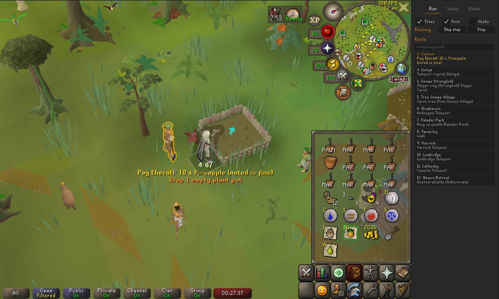
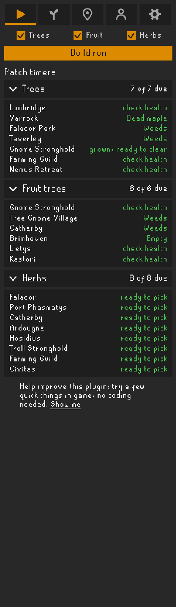
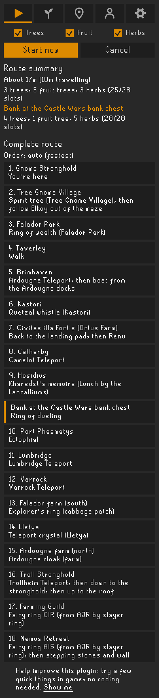
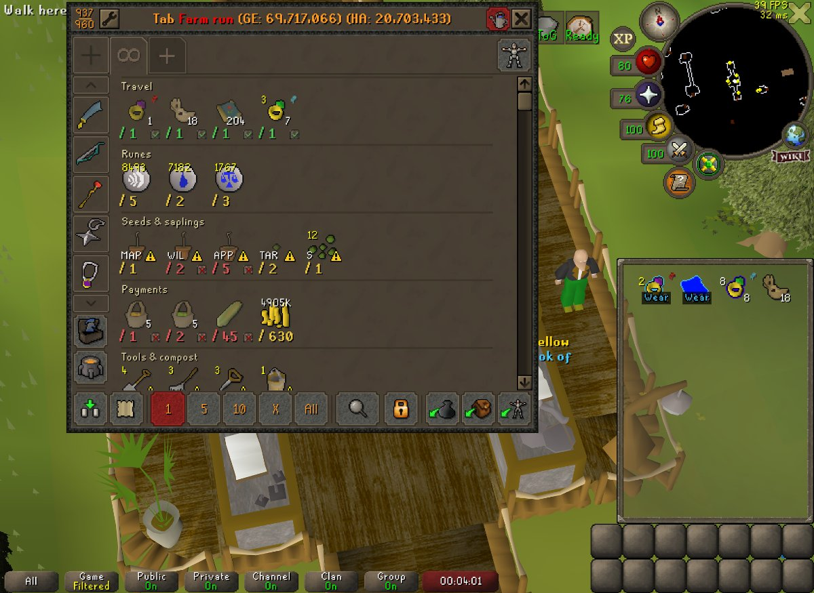
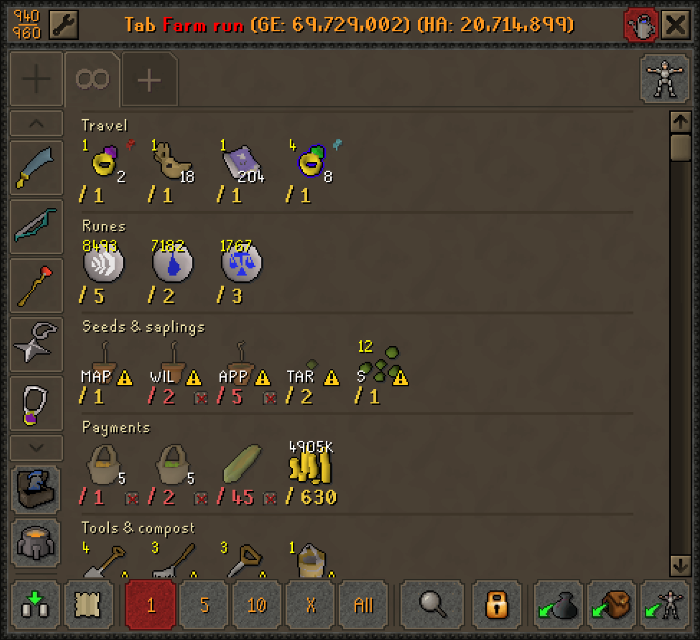
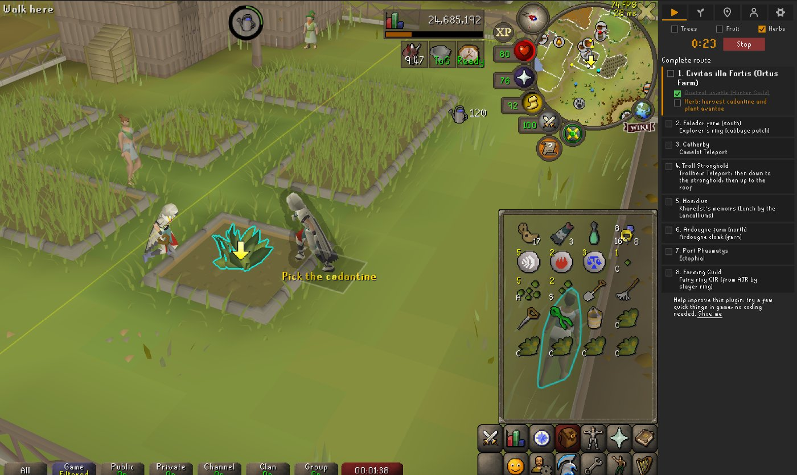
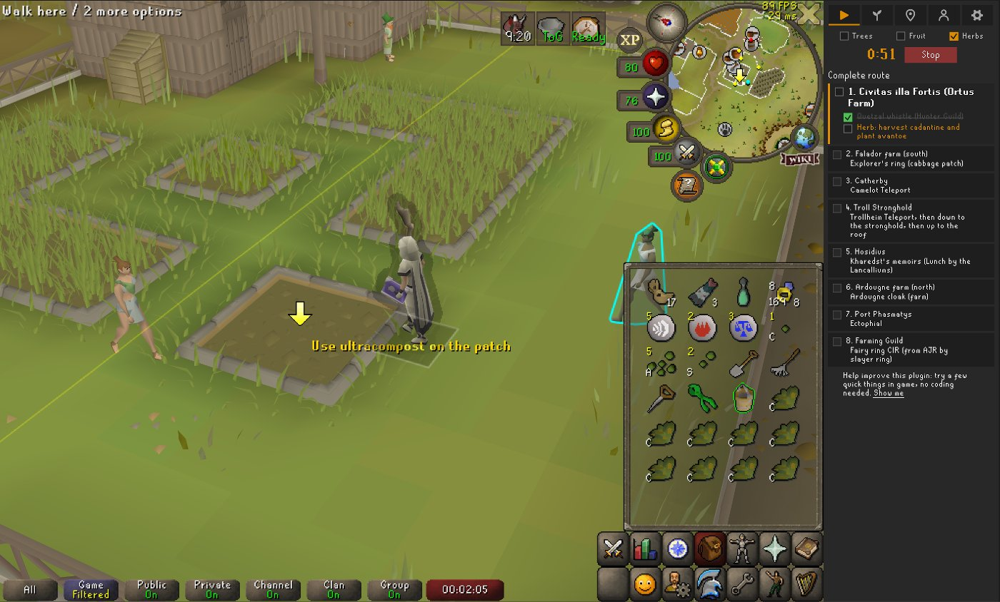
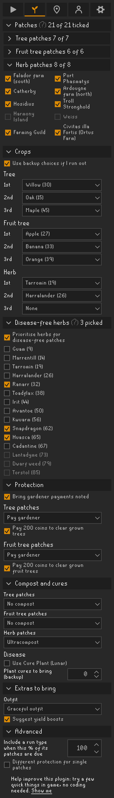

# Farm Run Autopilot

Plans and guides combined farming runs: what's due, the fastest route, exactly what to bring, and step-by-step
guidance at every patch. It covers trees, fruit trees, herbs, allotments, flowers, hops, bushes, cacti, mushrooms,
belladonna, seaweed and the special trees: hardwoods, calquats, celastrus, redwoods, spirit trees and the crystal tree.
Not covered yet: anima, Hespori, grapes, coral, the Entrana and Keldagrim hops patches and the Anglers' Retreat flax
patches.

The plugin never clicks, types or acts for you. It only shows information.

## Features

**Run tab**
- Patch timers for every run type, with what's due now and what's ready soon.
- One route across every due patch, using the teleports, items and unlocks you actually have. The route starts
  at the stop nearest you on foot and can end near a bank. Choose the order in Travel > Route: **Fastest** (the
  default), **The wiki's order**, or **My own order** (drag a stop to move it).
- The route shows each stop's way there, the whole run's time and where you'll stop at a bank when everything
  doesn't fit in one inventory. For a run that banks partway, a way a few seconds slower can be taken when leaving
  its item in the bank makes the whole run quicker; hover the stop to see why.
- Backup crop choices for when you run out, and your most valuable herbs sent to disease-free patches first.

  
  

**Bank**
- After you press **Build run**, a flashing "Farm run" button in the bank shows just the items you need, with
  how many of each: seeds and saplings, gardener payments (noted is fine), compost, tools and gear (gloves for
  belladonna, diving gear for the seaweed), coins, runes or tablets, travel items, and volcanic ash and empty buckets
  for the compost bins. Green is carried, yellow is in your bank or at the tool leprechaun, red is missing.
  A vine grows round the button while it waits for you.
- Equipment is chosen slot by slot: a staff that covers the run's runes is wielded ahead of magic secateurs, and
  teleport jewellery (a ring of dueling, say) is worn when its slot is free, saving an inventory slot. A second staff
  comes along when it saves more slots than its runes would take; the step before the stop that needs it says to
  wield it. A rune pouch counts as one slot.
- Barbarian seed planting is read from the game; once you've learned it, no run asks for a seed dibber.
- At a bank stop partway through a big run, it shows what to deposit first (with any seeds and saplings beyond
  what the next part plants), then what to take for it. Each part carries only its own seeds and saplings.

**Seed vault**
- In the Farming Guild's seed vault, a button by the close button shows a "Farm Run Autopilot" section at the
  top with the seeds to take and how many. Withdraw from it as usual.
- While you take seeds from it for a step, the inventory beside it counts down how many more to take, and says how
  many to put back if you took too many. The bank does the same for seeds and saplings.
- Getting ready goes in the same order every time: the seed vault first for whatever your bank is short of, then
  the bank, where you deposit everything (the Deposit inventory button is outlined) and take what the Farm run
  tab marks. For a run that banks partway, choose on the Account tab whether to take every seed at the start and
  keep the later ones in your bank, or to bank at the Farming Guild.

  
  

**During a run**
- Once you have everything (tools at the tool leprechaun count), the run starts itself, with each stop's steps
  as tick boxes on the Run tab and the current step under your character: where to go next, then each patch in
  turn (check health, pick, clear, rake, plant, compost, pay the gardener) before the next.
- The patch is outlined, with the hint arrow on its tile nearest you and that part of it marked. The gardener, the
  tool leprechaun and the compost bin are outlined when it's their turn. The seed, compost, plant cure or teleport
  to click next gets the growing vine in your inventory (a tool you only carry, like the rake, doesn't), and so
  does its tab's icon while another tab is open; when there are several to click, like grimy herbs, each loses its
  outline as you click it. The spell to cast gets the vine too, as does the place to pick on Renu's, the quetzal
  whistle's or a hot air balloon's map, and the code in a fairy ring's travel log. A teleport item's option is
  coloured in its right-click menu, and in its list of places with the number to press in front.
  Untick "Growing vine highlights" in Settings for plain outlines.
- Journeys are spelled out step by step: boats and ships, quetzals, gliders, balloons, carts, ladders, Elkoy, the
  dive to the seaweed patches, and Agility shortcuts when you have the level (the way round when you don't). The
  boat, NPC or object to use is outlined, with its option coloured in its right-click menu.
- With [Shortest Path](https://github.com/Skretzo/shortest-path) installed, a walking line to the next patch, tool
  leprechaun, compost bin or bank. Your Shortest Path settings are put back afterwards.
- The tool leprechaun is visited only when a stop needs it: for compost, a tool or room. Each visit also notes your
  produce, stores empty buckets and takes compost for the next stops when there's room. In his window, what to take
  or store is outlined with how many clicks are left, and so is the quantity button to click, so there's nothing to
  type.
- With compost bins on (Farm > At the patches), a ready bin is emptied first, with volcanic ash for ultracompost,
  then filled with the crops you pick and closed.
- Reminders to drop weeds and empty plant pots (and empty buckets, unless you keep or store them), or to take an
  item from the tool leprechaun. If your inventory fills while picking, making room is the step: put the crops in
  the compost bin, or note your produce.
- If something the run needs goes missing, the Run tab names it: Bank for them adds a bank visit, Skip carries
  on without them (a step that needs them is skipped).
- Steps tick off on their own (planting, composting, paying), and you can tick or untick any yourself. The run
  finishes after the last patch with your time against your best for each type of patch, and a new best is said in
  the game chat too. After each stop, the Run tab shows how far ahead of or behind your best pace you are.
- Your run times stay yours and never change the route. After three runs, the time estimate is at your own pace.

**Farm tab**
- Choose your patches, crops (with backups), disease-free herbs, protection (pay the gardener or compost
  only, per patch if you like; short of a payment, the best compost you have is used instead), compost and
  plant cures. Each set of allotments can be protected by the flower beside it instead.
- Each type of patch has a tick box of its own: ticked with all its patches on, a dash with some off. Click it to
  tick or untick them all at once.
- At the patches: clean herbs after picking, note your produce with the tool leprechaun, drop, keep or store empty
  buckets, and make compost in the compost bins. Fruit trees, bushes, cacti and calquats can be picked and left
  growing, and spirit trees kept for travel (Leave growing after picking). Grown trees can be cleared by their
  gardener for 200 coins instead of chopped (Pay 200 coins to clear grown); a redwood is always cleared by Alexandra,
  for 2,000 coins.
- Farming contracts: the Farming Guild's patches hold the wiki's pre-plants and are left alone until Guildmaster Jane's
  contract asks for one; anything else growing there is picked once grown and the pre-plant planted, once you have its
  seed. The contract's crop
  is checked or picked once grown and the patch replanted, and the guild stop ends at Jane, outlined: hand in, take
  another (the highest tier your level allows), or ask for an easier one when a slow crop's patch is taken.

**Travel tab**
- Every stop's way is planned for you from a travel map worked out with Shortest Path's data: every teleport,
  item, fairy ring, spirit tree, boat and shortcut your account can use, through your house too. There's nothing
  to pick per stop.
- Ways to travel lists the families of ways: spells, teleport items, tablets and scrolls, your house, fairy rings,
  spirit trees, quetzals, boats and ships, gliders, balloons and carts, home and minigame teleports, and Agility
  shortcuts, each with how many you can use. Untick a family and the route doesn't use it. Open one to see each of
  its ways: ticked when the route can use it, greyed out until it can (hover to see what it needs, or that it has no
  charges or uses left today). Untick one you won't use: the family's tick box then shows a dash, and ticking it again
  turns every way back on. On the Run tab, right-click a stop for "Don't use ..." on its way. The route is planned
  again without it, and your choices stay whichever preset you use.
- Home and minigame teleports are off to start with. Turned on, the route uses at most one of each per run, once its
  cooldown is over. "Avoid the Wilderness" is on to start with (the Ferox Enclave counts as safe). "Switch spellbook to
  cast" is off to start with: tick it to let the route cast a spell from another spellbook after Spellbook Swap or at
  your house altar.
- In Route, choose the order, where the run starts, and a travel style: Fastest, Prefer free or Save charges.
- Tablets come first; tick "Cast from runes, not tablets" (under Tablets and scrolls) to keep yours.
- Charges are tracked across the whole run: jewellery charges, daily-limited teleports (Ardougne cloak,
  Explorer's ring) and items charged by hand (quetzal whistle, Xeric's talisman, pendant of Ates, counted from
  your teleports). When one runs out partway, the next best way is used.
- A spirit tree near your last stop can be the way into your house, then out through its portal, nexus,
  jewellery box or fairy ring.

**Account tab**
- Your house (nexus, jewellery box, altar, spirit tree, fairy ring), with an optional scan that fills it in
  when you go home. Where it is, and where Teleport to House lands, are read from the game.
- Unlocks the game doesn't show, and the storage the plugin counts from (seed vault, group storage, tool
  leprechaun, bottomless bucket).

**Settings tab**
- Presets (e.g. "Quick herbs"), display options, and what the plugin has detected: quests, diaries, levels,
  spellbook, your house, charges and unlocks.
- **Help improve this plugin:** try a guided test of a feature the author couldn't test. A test walks you through it
  on the Run tab and puts your settings back afterwards. The "Quick tests in game" line at the bottom of each tab
  opens this section.
  "Report a problem" there opens GitHub's bug form with the plugin version and your current plan filled in.

## How to use

1. Open the Farm Run Autopilot sidebar (the leprechaun icon).
2. Set things up once: patches, crops, protection and compost on the Farm tab; the travel style and the route on
   the Travel tab; your house, unlocks and storage on the Account tab.
3. On the Run tab, tick the run types and press **Build run**.
4. Follow Getting ready on the Run tab: any seeds your bank is short of from the seed vault first, then at your
   bank deposit everything and click the flashing "Farm run" button to take what you need. The run starts itself
   once you have everything; the timer starts when you teleport or click your first patch, its gardener, compost
   bin or tool leprechaun (or press **Start now**).
5. Follow the steps under your character.

Patches are tracked as you visit them. Until then, the plugin uses RuneLite's Time Tracking data if it has
any.

## Privacy

Everything is stored in your RuneLite profile, run times included (they stay yours: for the estimate and your best
times). The plugin makes no network requests. A guided test's report and "Report a problem" only open a GitHub issue
in your browser when you press their button; nothing is sent unless you submit it there, and they never include your
character name or where you've been.

## Credits

- Generated bank tab approach adapted from [Quest Helper](https://github.com/Zoinkwiz/quest-helper).
- Tree, fruit tree and herb patch coordinates from [Farming-Helper](https://github.com/Speaax/Farming-Helper).
- The travel map (every way to every patch, and what each needs) worked out ahead of time with
  [Shortest Path](https://github.com/Skretzo/shortest-path)'s own pathfinder and data. Nothing is downloaded while
  you play.
- Special tree research (the Great Conch's access, clearing fees, Anglers' Retreat) from
  [@MangoTheFlamingo](https://github.com/MangoTheFlamingo) and their
  [Tree Run Planner](https://github.com/MangoTheFlamingo/TreeRuns).
- Patch, crop and compost bin data from RuneLite's Time Tracking, and game facts checked against the
  [Old School RuneScape Wiki](https://oldschool.runescape.wiki).
- Built on [RuneLite](https://github.com/runelite/runelite).

See `THIRD_PARTY_NOTICES` for their licences.

## Special thanks

To everyone who has offered to help, tried the plugin and said what they found:

- [@MangoTheFlamingo](https://github.com/MangoTheFlamingo), for offering to help with the special trees and
  answering the plan's open questions, and for pointing out that crystal trees were missing (#30).
- [@elwakka](https://github.com/elwakka), for the first bug reports (#1, #2, #3, #6, #7), for eight guided test reports,
  and for the ideas of not travelling to a stop you're already at (#1) and using your house as a way through when you
  arrive by spirit tree (#16).
- [@ConnorBampton](https://github.com/ConnorBampton), for guided test reports (#28, #29) and the ideas of casting
  Teleport to House from runes instead of tabs (#27) and planting from the seed box (#26).
- [@darkshadow0308](https://github.com/darkshadow0308), for guided test reports (#20, #21).
- [@Zerkia](https://github.com/Zerkia), for the ideas of calquat trees (#22) and more ways to Weiss and more say
  over your setup (#24), and a bug report (#23).
- [@iieu8827roj](https://github.com/iieu8827roj), for the idea of using the rune pouch (#31).
- [@helpimtrappedinawebserver](https://github.com/helpimtrappedinawebserver), for the Spellbook Swap test report (#32).
- [@winter-mark](https://github.com/winter-mark), for the idea of a bank step to make room for the harvest (#33).
- [@chins4tw-sketch](https://github.com/chins4tw-sketch) and [@Mr2Cookies](https://github.com/Mr2Cookies), for the
  report of Taverley's tree passed over after the balloon (#35), and Mr2Cookies for asking to leave fruit trees
  growing (#39).
- [@backwardspy](https://github.com/backwardspy), [@frazzorr](https://github.com/frazzorr),
  [@collinphood-svg](https://github.com/collinphood-svg) and [@ColdStoneCode](https://github.com/ColdStoneCode), for
  reports (#4, #5, #25, #34).

Want to help? Settings > Help improve this plugin lists a few quick in-game tests, and the
[issues](https://github.com/elzerma/farm-run-autopilot/issues) take bug reports and ideas.

## Licence

BSD 2-Clause, see `LICENSE`.
